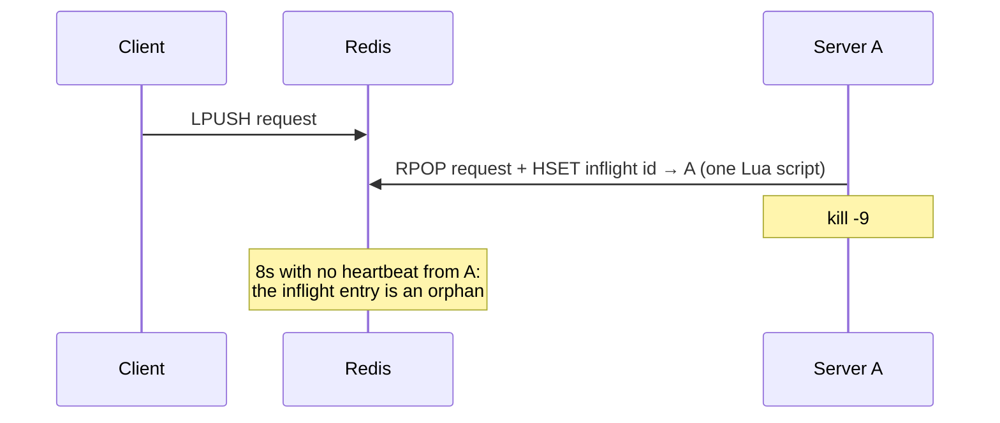
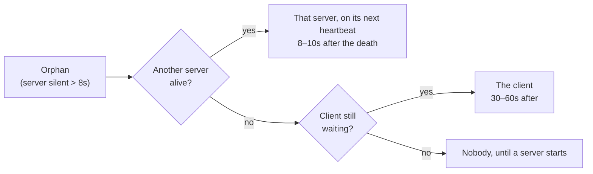

# Reaping

When a server dies in the middle of a request, someone has to tell the client
its response is never coming. That's reaping. Either a live server does it, or
the client that's waiting does it on its own.

To watch it step by step, open [visuals/reaping.html](visuals/reaping.html) in
a browser.

## The pieces

| Redis key | Written by | Holds |
|---|---|---|
| `anycall:inflight` | servers | request id → id of the server processing it |
| `anycall:servers:alive` | servers | every server's last heartbeat (every 2s), by Redis's clock; alive if under 8s old |
| `anycall:responses:<id>` | servers, reapers | the response a client waits on with `BRPOP` |

None of them hold the method name, so any server can reap any other server's
requests, whatever methods each one serves. Reaping never runs the request
again. It only fails it back to its client.

## How a request becomes an orphan

A server takes a request and records it in `anycall:inflight` in one atomic
step. When it's done, it pushes the response first and only then removes the
entry. If it dies between the two, the entry gets reaped, but the client still
reads the real response first, because `BRPOP` takes the oldest item.

## Who reaps it

### Heartbeat reaping (servers)

Every 2s, each live server:

1. reads `anycall:inflight`;
2. runs its heartbeat script, which refreshes its own entry, prunes servers
   older than 8s and returns the ones still alive;
3. for each entry whose owner isn't alive, removes it with `HDEL` and, if that
   call removed it, pushes a server-lost error to the response queue with a 60s
   expiry.

It reads the owners before the live servers. In the other order, a server that
started and took a request between the two reads would look dead.

### Waiter-driven reaping (clients)

With no other server alive, nobody would reap, and since calls wait with no
limit by default, the client would wait forever. So the waiting call does it:

1. It waits on `BRPOP` in slices of up to 30s instead of one long wait.
2. When a slice ends empty, it checks a timer shared by every call of that
   client. If there's been no sign of a live server for 30s, it takes a lock
   (`tryLock`) and does the same work a server would. Other calls see the lock
   taken and go back to waiting.
3. If the orphan was its own request, the error is already in its queue when it
   goes back to `BRPOP`.

The timer resets when:
- any call of the client gets a response;
- a call finds a live server in its check before publishing;
- a reaping run ends, so calls with offset slices don't each reap every 30s.

The first two count because any live server reaps every orphan, so one is
enough. In Java, reaping opens a short-lived connection of its own, since the
client's only connection may be blocked in another thread's `BRPOP`.

### The claim

Several servers, and a client, can notice the same orphan at once. `HDEL`
removes the entry for exactly one of them, and only that one writes the error.
The caller never gets two.

## What the caller sees

| Error | Means | Did the request run? |
|---|---|---|
| `ServerLostError` | The server holding the request stopped heartbeating. Carries that server's id. | It started and may have partly run. Nobody will answer. Retry only if it's idempotent. |
| `TimeoutError` | The configured timeout ran out. | Unknown: slow server, a server lost too recently to notice, or never taken. |

A reaper's response carries a `lostServer` field. That's how the client tells
a lost server apart from the method's own error (`RemoteException`).

## Not covered

- **A request still in its queue.** It isn't in `anycall:inflight`, so it isn't
  an orphan. With no server alive, or none serving its method, it waits out the
  timeout.
- **A client that already gave up, with no server alive.** Nobody is waiting,
  so nobody reaps. The entry stays until a server starts, and that server's
  heartbeat reaps it.

## Timings

| | Value |
|---|---|
| Heartbeat period | 2s |
| Heartbeat TTL (a server counts as dead after) | 8s |
| Client wait slice | 30s |
| Client quiet period before it reaps | 30s |
| Expiry on a reaper's error response | 60s |
| Heartbeat reaping, after a `kill -9` | 8–10s (measured 7.6–7.9s) |
| Waiter-driven reaping, after a `kill -9` | 30–60s (measured 30.0–30.4s) |

The visualizer estimates when each orphan will be reaped: within ~2s with a
server alive, otherwise 8–68s after the last heartbeat it saw. It's an estimate
because the client's timer lives in the client process and never reaches
Redis.
