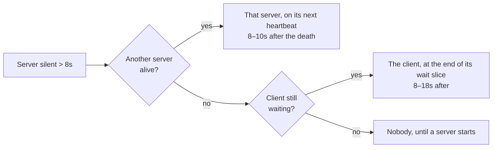

# Reaping

When a server dies in the middle of a request, reaping tells the client its
response is never coming. Live servers do it on every heartbeat, and waiting
clients do it whenever a wait slice ends empty.

Reaping never runs the request again. It only fails it back to its client.

## The pieces

| Redis key | Written by | Holds |
|---|---|---|
| `anycall:processing:<server>` | servers | the requests that server is processing (see [taking-requests.md](taking-requests.md)) |
| `anycall:servers:alive` | servers | every server's last heartbeat, by Redis's clock |
| `anycall:responses:<id>` | servers, reapers | the response a client waits on |

A server heartbeats every 2s and counts as dead when its heartbeat is over 8s
old. A dead server stays in `anycall:servers:alive` until it's reaped, because
its entry is how its processing list gets found.

## The claim

Anyone who finds a heartbeat older than 8s runs one Lua script on that server:

```lua
-- KEYS[1] = anycall:servers:alive, KEYS[2] = anycall:processing:<server>
-- ARGV[1] = the server's id, ARGV[2] = 8 (seconds)
local score = redis.call('ZSCORE', KEYS[1], ARGV[1])
if not score then return {} end -- in this case the server were reaped
local t = redis.call('TIME')
local now = tonumber(t[1]) + tonumber(t[2]) / 1000000
if tonumber(score) >= now - tonumber(ARGV[2]) then return {} end
redis.call('ZREM', KEYS[1], ARGV[1])
local items = redis.call('LRANGE', KEYS[2], 0, -1)
redis.call('DEL', KEYS[2])
return items
```

If the server is gone from the set, or its heartbeat is no longer that old,
the script returns nothing and changes nothing. Otherwise it atomically:

1. removes the server from `anycall:servers:alive`;
2. reads its whole processing list and deletes it;
3. returns what was on it.

The caller then pushes a server-lost error, with a 60s expiry, to the response
queue of each request it got back.

When several reapers find the same dead server, only the first gets its
requests, so a client never gets two errors. A server that heartbeats again
before the claim is left alone.

## Who reaps it



- **Servers:** the heartbeat script refreshes the server's own entry and
  returns the servers that are dead. The server runs the claim on each.
- **Clients:** a call waits on `BRPOP` in slices of up to 10s. When a slice
  ends empty, the client lists the dead servers and runs the claim on each. If
  its own request was among them, the error is in its queue on the next
  `BRPOP`. The Java client uses a second connection for this, opened the first
  time a slice ends empty.

## What the caller sees

| Error | Means | Did the request run? |
|---|---|---|
| `ServerLostError` | The server holding the request stopped heartbeating. Carries that server's id. | It started and may have partly run. Retry only if it's idempotent. |
| `TimeoutError` | The configured timeout ran out. | Unknown: a slow server, a server lost too recently to notice, or a request never taken. |
| `BrokerError` | A Redis command failed during the call. | No if `published` is false; otherwise unknown. |

A reaper's response carries a `lostServer` field, which is how the client
tells a lost server apart from the method's own error (`RemoteException`).

## Edge cases

- **A server reaped while still alive.** A server that misses heartbeats for
  8s, say during a long GC pause, has its requests failed back. Its next
  heartbeat re-registers it and logs a warning. The responses it still writes
  are never read and expire after 60s.
- **A request still in its queue.** It isn't on any processing list, so it
  isn't reaped. With no server serving its method, it waits out the timeout.
- **No server alive and no client waiting.** Nobody reaps. The list stays
  until a server starts, and that server's heartbeat reaps it.
- **A reaper that dies between the claim and writing the errors.** The claim
  already removed the requests, so their clients wait out their timeout. The
  window is one round trip.

## Timings

| | Value |
|---|---|
| Heartbeat period | 2s |
| A server counts as dead after | 8s |
| Client wait slice | 10s |
| Expiry on every response | 60s |
| Reaped by another server, after a `kill -9` | 8–10s |
| Reaped by the waiting client, after a `kill -9` | 8–18s |

Measured with `kill -9` on a server holding a request, Python and Java: the
request was failed back 7–8s after the kill with another server alive, and
about 8s with none. The kill came 0–2s after the server's last heartbeat, so a
slower case takes up to the bounds above.
