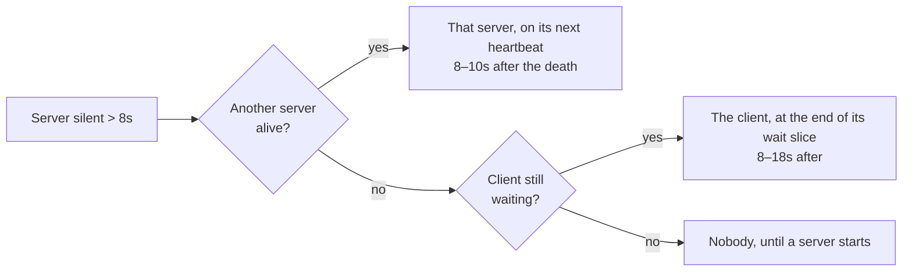

# Reaping

When a server dies in the middle of a request, reaping tells the client its
response is never coming. Live servers do it on every heartbeat, and waiting
clients do it whenever a wait slice ends empty.

Reaping never runs the request again. It only fails it back to its client.

## The pieces

| Redis key | Written by | Holds |
|---|---|---|
| `anycall:processing:<server>` | servers, reapers | the requests that server is processing (see [taking-requests.md](taking-requests.md)); once a dead server is reaped, a tombstone |
| `anycall:servers:alive` | servers | every server's last heartbeat, by Redis's clock |
| `anycall:responses:<client>` | servers, reapers | every response to that client's calls; the client hands each to its call by requestId |

A server heartbeats every 2s and counts as dead when its heartbeat is over 8s
old. A dead server stays in `anycall:servers:alive` until it's reaped, because
its entry is how its processing list gets found.

## Failing back a request

Anyone who finds a heartbeat older than 8s fails back that server's requests
one at a time, each in a transaction of its own:

```
WATCH  anycall:processing:<server>
LINDEX anycall:processing:<server> -1       -- the next request, not removed
                                            -- (the reaper reads its requestId and clientId)
MULTI
LTRIM  anycall:processing:<server> 0 -2     -- drops the last one: the request read
LPUSH  anycall:responses:<clientId> <server-lost error for requestId>
EXPIRE anycall:responses:<clientId> 60
EXEC
```

The request leaves the list in the same `EXEC` that writes its error, so a
reaper that dies at any point leaves it on the list for the next one.

When the list is empty, one script removes the server from
`anycall:servers:alive` and turns its processing key into a **tombstone**: a
string, kept 30 days. A take onto a tombstone fails with `WRONGTYPE`, and Redis
leaves the request in its queue. So nothing can land on a dead server's list
after it was reaped, where no one would look anymore. A reaper that finds the
tombstone already there knows the server was reaped, and stops.

`WATCH` cancels the `EXEC` if anything changed the list since it was read:
another reaper took the request first. The reaper then reads again. So when
several reapers find the same dead server, each request is failed back by
exactly one of them.

Nothing needs checking about the server first: once its heartbeat is over 8s
old, it's dead for good. The heartbeat script refuses its id from then on, so
it can't come back while being reaped.

The request is read with a plain `LINDEX`, not inside a Lua script: copying a
large request into Lua blocks Redis several times longer than a plain read
(1.5ms against 0.14ms for 1MB).

## Who reaps it



- **Servers:** the heartbeat script refreshes the server's own entry and
  returns the servers that are dead. The server fails back their requests on
  a connection of its own, since `WATCH` and `MULTI` belong to a connection.
- **Clients:** a call waits on `BRPOP` in slices of up to 10s. When a slice
  ends empty, the client lists the dead servers and fails back their
  requests. If its own request was among them, the error is in its queue on
  the next `BRPOP`. The Java client uses a second connection for this, opened
  the first time a slice ends empty, and one call at a time uses it.

## What the caller sees

| Error | Means | Did the request run? |
|---|---|---|
| `ServerLostError` | The server holding the request stopped heartbeating. Carries that server's id. | It started and may have partly run. Retry only if it's idempotent. |
| `TimeoutError` | The configured timeout ran out. | Unknown: a slow server, a server lost too recently to notice, or a request never taken. |
| `BrokerError` | A Redis command failed during the call. | No if `published` is false; otherwise unknown. |

A reaper's response carries a `lostServer` field, which is how the client
tells a lost server apart from the method's own error (`RemoteException`).

## Edge cases

- **A server declared dead while still running.** A server that misses
  heartbeats for 8s (a long GC pause, a frozen VM, Redis unreachable) has its
  requests failed back, and its list becomes a tombstone. When it resumes,
  its old id drains, as soon as its heartbeat is refused or a take hits the
  tombstone: it logs a warning and carries on under a new server id. The
  requests still running under the draining id finish with their results
  discarded, holding their concurrency slots until then. A take that hit the
  tombstone left its request in the queue, so it's served under the new id.
  Once no take is left on the draining id, the server deletes its own
  tombstone.
- **A server frozen longer than the tombstone's 30 days.** It may lose a
  request taken in the moment before it notices it's dead. It's the only
  case reaping can't cover.
- **A request still in its queue.** It isn't on any processing list, so it
  isn't reaped. With no server serving its method, it waits out the timeout.
- **No server alive and no client waiting.** Nobody reaps. The list stays
  until a server starts, and that server's heartbeat reaps it.
- **A reaper that dies halfway.** Every request it hadn't failed back yet is
  still on the dead server's list, which is still in `anycall:servers:alive`,
  so the next reaper carries on.

## Timings

| | Value |
|---|---|
| Heartbeat period | 2s |
| A server counts as dead after | 8s |
| Client wait slice | 10s |
| Expiry on every response | 60s |
| Reaped by another server, after a `kill -9` | 8–10s |
| Reaped by the waiting client, after a `kill -9` | 8–18s |

Measured with `kill -9` on a server holding a request, Python and Java: the
request was failed back 7–8s after the kill with another server alive, and
about 8s with none. The kill came 0–2s after the server's last heartbeat, so a
slower case takes up to the bounds above.
