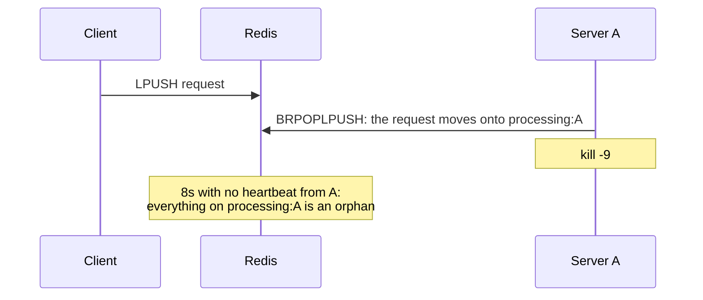
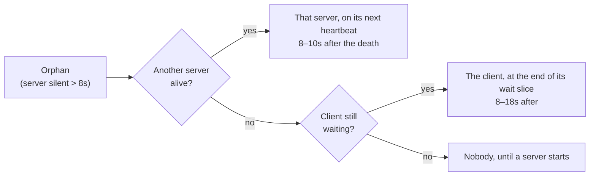

# Reaping

When a server dies in the middle of a request, someone has to tell the client
its response is never coming. That's reaping. Live servers do it on every
heartbeat, and waiting clients do it whenever a wait slice ends empty, with the
same code.

## The pieces

| Redis key | Written by | Holds |
|---|---|---|
| `anycall:processing:<server>` | servers | the requests that server is processing (see [taking-requests.md](taking-requests.md)) |
| `anycall:servers:alive` | servers | every server's last heartbeat (every 2s), by Redis's clock; alive if under 8s old |
| `anycall:responses:<id>` | servers, reapers | the response a client waits on with `BRPOP` |

A dead server stays in `anycall:servers:alive` until it's reaped. Nothing prunes
it by age alone, because its entry is how its processing list gets found.

Reaping never runs the request again. It only fails it back to its client.

## How a request becomes an orphan

## The claim

Anyone who finds a server's heartbeat older than 8s runs one Lua script on it.
If the heartbeat is still that old, the script, atomically:

1. removes the server from `anycall:servers:alive`;
2. reads its whole processing list and deletes it;
3. returns what was on it.

The caller then pushes a server-lost error, with a 60s expiry, to the response
queue of each request it got back.

Several servers and clients can find the same dead server at once. The script
runs once per caller, but only the first finds the server still there, so only
that one gets its requests and writes the errors. A client never gets two.

The script checks the age again, inside the same atomic step, so a server that
heartbeated between being listed as dead and the claim is left alone.

## Who reaps it

Whoever gets there first does it.

### On the heartbeat (servers)

Every 2s, each live server runs its heartbeat script, which refreshes its own
entry and returns the servers whose heartbeat is older than 8s. When none is,
that's the whole cost. For each one it returns, the server runs the claim.

### On the wait (clients)

A call waits on `BRPOP` in slices of up to 10s instead of one long wait. When a
slice ends empty, it lists the servers whose heartbeat is older than 8s (one
script call) and runs the claim on each. If its own request was among them, the
error is in its queue when it goes back to `BRPOP`.

This is what covers a request whose server died with no other server alive. The
Java client runs it on a second connection, opened the first time a slice ends
empty, since its main connection may be blocked in another thread's `BRPOP`.

## A server reaped while still alive

A server that misses heartbeats for 8s, say during a long GC pause, is reaped
like a dead one: its requests are failed back. When it comes back, its next
heartbeat re-registers it and logs a warning, and the responses it still writes
land in their queues after the error, where the client never reads them and the
60s expiry removes them.

## What the caller sees

| Error | Means | Did the request run? |
|---|---|---|
| `ServerLostError` | The server holding the request stopped heartbeating. Carries that server's id. | It started and may have partly run. Nobody will answer. Retry only if it's idempotent. |
| `TimeoutError` | The configured timeout ran out. | Unknown: slow server, a server lost too recently to notice, or never taken. |

A reaper's response carries a `lostServer` field. That's how the client tells
a lost server apart from the method's own error (`RemoteException`).

## Not covered

- **A request still in its queue.** It isn't on any processing list, so it
  isn't an orphan. With no server alive, or none serving its method, it waits
  out the timeout.
- **A client that already gave up, with no server alive.** Nobody is waiting,
  so nobody reaps. The list stays until a server starts, and that server's
  heartbeat reaps it.
- **A reaper that dies between the claim and writing the errors.** The claim
  already removed the requests, so their clients wait out their timeout. The
  window is one round trip, during a reap.

## Timings

| | Value |
|---|---|
| Heartbeat period | 2s |
| Heartbeat TTL (a server counts as dead after) | 8s |
| Client wait slice | 10s |
| Expiry on every response (a server's or a reaper's) | 60s |
| Reaped by another server, after a `kill -9` | 8–10s |
| Reaped by the waiting client, after a `kill -9` | 8–18s |

Measured with `kill -9` on a server holding a request, Python and Java: failed
back 7–8s after the kill with another server alive, and about 8s with none, by
the client. The kill came 0–2s after the server's last heartbeat, and each
client's slice happened to end soon after the 8s, so a slower case takes up to
the bounds above.

The visualizer estimates when each orphan will be reaped: within ~2s with a
server alive, otherwise 8–18s after the dead server's last heartbeat it saw.
It's an estimate because where a client is in its wait slice never reaches
Redis.
