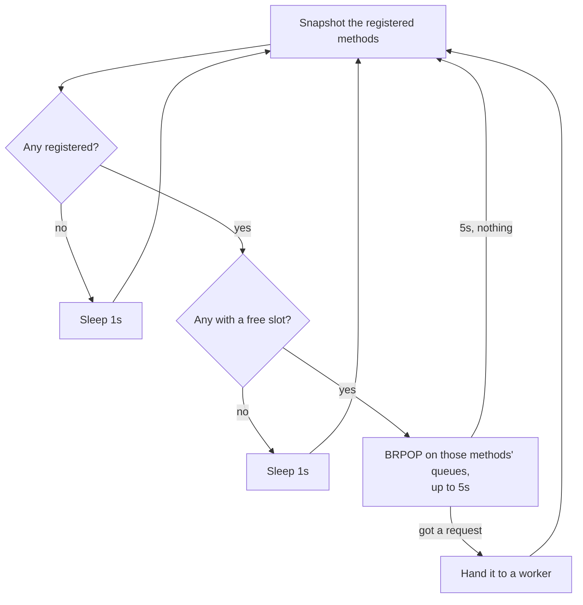
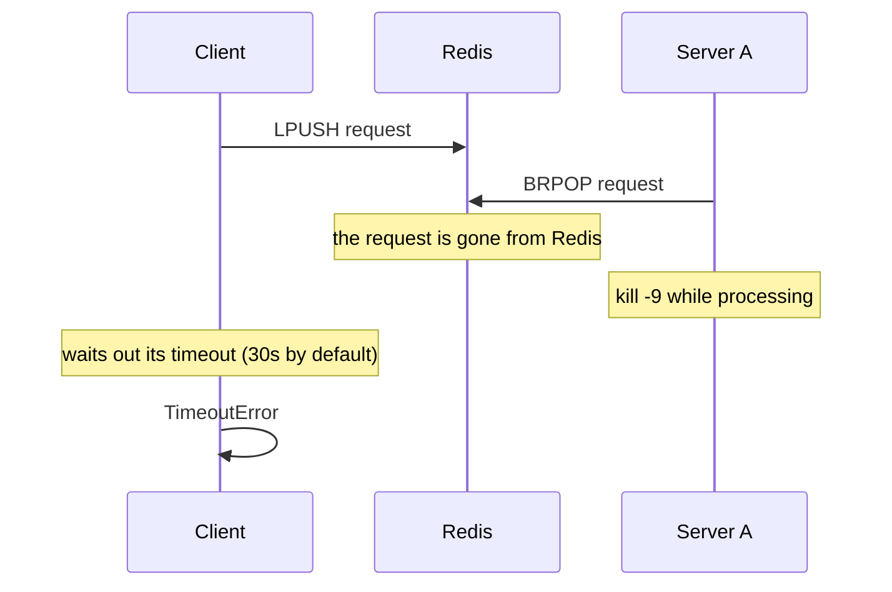

# Taking requests (legacy)

How servers took requests before `ae10ab9` (*fail a request back to its client
when its server dies mid-processing*). It's kept to explain why the current
design looks the way it does. For how it works now, see
[taking-requests.md](taking-requests.md).

To watch it step by step, open
[visuals/taking-requests-legacy.html](visuals/taking-requests-legacy.html) in a
browser.

## The pieces

| Redis key | Written by | Holds |
|---|---|---|
| `anycall:requests:<method>` | clients | requests nobody has taken yet |
| `anycall:responses:<id>` | servers | the response a client waits on with `BRPOP` |
| `anycall:servers:alive` | servers | heartbeats, read only by tooling and clients |

There was no `anycall:inflight` and no `anycall:wake:<method>`. Which requests
a server was processing lived only in its own memory (`inFlightRequestIds` /
`_in_flight_request_ids`).

## The read loop

One loop per server, on its own connection:

`BRPOP` blocks inside Redis until one of the queues has an entry, and Redis
hands it to exactly one waiting server. So a server heard about a new request
the instant it was pushed, with no wake channel and no polling. The client only
did `LPUSH`, then `BRPOP` on its response queue.

The server used three connections: read, write and heartbeat.

## What a crash did

`BRPOP` removed the request from Redis the moment the server took it. The only
record that the server had it was in that server's memory, and that died with
it. Nobody else could notice:

- other servers couldn't take it again, because it wasn't in any queue;
- no one could fail it back, because nothing in Redis said it was in flight.

The client got a `TimeoutError` once its timeout ran out, 30s by default. That
error can't tell a dead server from a slow one. And it wasn't only the instant
between taking and recording: a crash at any point while processing lost the
request the same way.

## Side effects of a fixed key list

`BRPOP` takes its list of queues when the call starts, and only for methods
with a free slot at that moment. While it blocks, nothing changes that list:

| What happens during the `BRPOP` | Noticed |
|---|---|
| A request arrives for a method being listened to | at once |
| A method is registered | when the `BRPOP` returns, up to 5s later |
| A busy method frees a slot | when the `BRPOP` returns, up to 5s later |
| Every method is at its limit | the loop sleeps 1s and looks again |

## Why it changed

To make crashes visible, taking a request had to also write down who has it, in
the same atomic step. `BRPOP` can't do that. A Lua script can, but a script
can't block. So the current design adds:

| Legacy | Current |
|---|---|
| `BRPOP` (blocks) | `ACQUIRE_SCRIPT`: `RPOP` + `HSET anycall:inflight` (doesn't block) |
| In-flight set in the server's memory | `anycall:inflight` in Redis, read by reaping |
| Redis wakes the server | the client publishes on `anycall:wake:<method>`, with a 1s fallback |
| Crash → `TimeoutError` after the timeout | crash → `ServerLostError` in 8–10s, or 30–60s with no other server |
| 3 connections per server | 4 (the wake subscription) |

A side benefit: the loop rereads its methods and free slots every time it
wakes, so a new method or a freed slot is noticed at once, not up to 5s later.

## Timings

| | Value |
|---|---|
| `BRPOP` block per call | 5s |
| Sleep with no methods, or all at their limit | 1s |
| Default client timeout | 30s |
