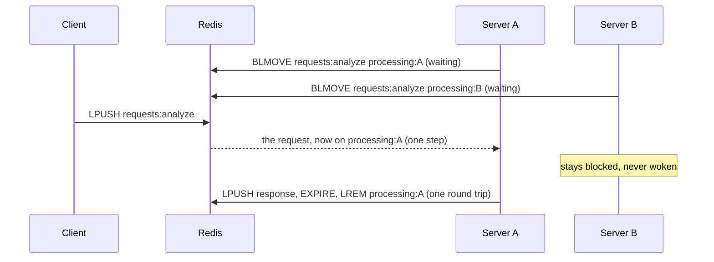

# Taking requests

A server takes a request off its queue and onto a list of its own in one
atomic command, so a crash can never lose a request without a trace. The
command blocks, so an idle server is handed a new request the moment a client
pushes it.

To watch it step by step, open
[visuals/taking-requests.html](visuals/taking-requests.html) in a browser.

## The pieces

| Redis key | Written by | Holds |
|---|---|---|
| `anycall:requests:<method>` | clients | requests nobody has taken yet |
| `anycall:processing:<server>` | servers | the requests that server is processing, whole |

## Taking a request

`BLMOVE anycall:requests:<method> anycall:processing:<server> RIGHT LEFT` pops
the request and pushes it onto the server's processing list in one step. On a
Redis before 6.2, which has no `BLMOVE`, the server uses the equivalent
`BRPOPLPUSH`; it asks Redis which one on start. The
request is always in one of the two places, so a crash falls before the
command or after it:

- **before:** the request is still in its queue, and another server takes it;
- **after:** it's on the list of the server that died, and
  [reaping](reaping.md) fails it back with `ServerLostError`.

The name of the processing list says which server has the request, so Redis
always knows who to hold responsible for it.



Redis hands each push to exactly one blocked server. The others stay blocked,
so idle servers add nothing to the cost of a call.

When it's done, the server pushes the response, sets its expiry and removes
the request from its processing list, in one round trip, response first. If
the process dies before the removal, the request is failed back as a crash,
but the client pops the real response before that error, because `BRPOP`
takes the oldest.

## One loop, and one connection, per method

`BLMOVE` reads a single queue, and a blocked command holds its connection
until it returns. So a server runs one read loop per method it serves, each on
its own connection:

```
loop for "analyze":
    wait for a free slot (the method's max_concurrency)
    BLMOVE requests:analyze processing:A, up to 2s
    hand the request to a worker
```

- **Per-method concurrency** is the loop not asking for the next request until
  a slot frees up. Requests for a busy method stay in their queue, so its
  backlog stays accurate.
- **The server-wide cap** (`max_concurrency` on the server) gates running a
  request, not taking it. A loop blocked in Redis can't hold a server-wide slot
  without starving the other methods, so a request taken while every slot is
  busy waits in the server for one, already safe on the processing list. Taking
  overshoots the cap by at most one request per method.
- **The 2s block** bounds how long `stop` and `unregister` take to reach an
  idle loop. An idle loop costs one command per 2s.

A server uses one connection per method, plus:

- **Java:** one more, shared by every worker's responses and the heartbeat.
- **Python:** about one more per worker, since a redis-py connection serves
  one command at a time.

Blocked connections cost Redis no CPU, only memory, about 57 KB each.
