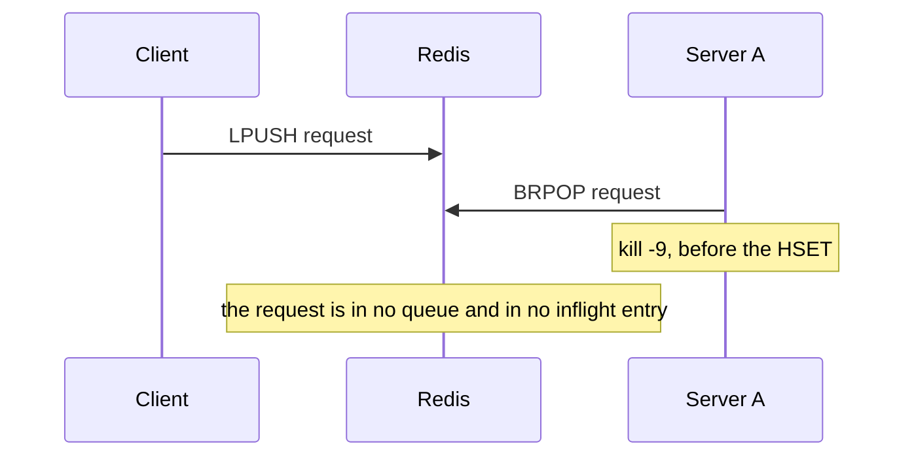
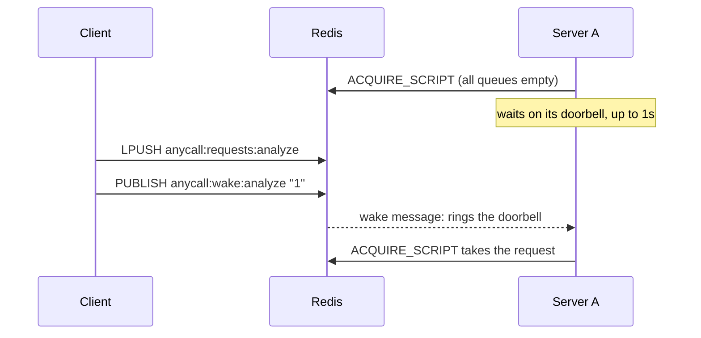

# Taking requests

A server takes a request off its queue and writes down that it has it in one
atomic step, so a crash can never lose a request without a trace. That step
can't block, so clients ring a doorbell after every push to tell idle servers
to look.

To watch it step by step, open
[visuals/taking-requests.html](visuals/taking-requests.html) in a browser.

## The pieces

| Redis key | Written by | Holds |
|---|---|---|
| `anycall:requests:<method>` | clients | requests nobody has taken yet |
| `anycall:wake:<method>` | clients | a pub/sub channel, no data: "there may be something new" |
| `anycall:inflight` | servers | request id → id of the server processing it |

## The gap a crash could fall into

Servers used to take requests with a plain `BRPOP` and record nothing in Redis
(see [taking-requests-legacy.md](taking-requests-legacy.md)). Adding an `HSET`
after it would still be two commands:

Between the two, the request exists only in the server's memory. If the server
dies there, no other server can take it, because it's gone from the queue, and
reaping can't fail it back, because it never reached `anycall:inflight`. Calls
wait with no limit by default, so the client would wait forever. The window is
one round trip, so it's rare, but when it happens nothing reports it.

## One step instead

`ACQUIRE_SCRIPT` is a Lua script that does the `RPOP` and the `HSET` together.
Redis runs a script without interleaving anything else, so a crash falls before
it or after it:

- **before:** the request is still in its queue, and another server takes it;
- **after:** it's in `anycall:inflight` under the dead server's id, and
  [reaping](reaping.md) fails it back with `ServerLostError`.

The script takes a list of queues and pops from the first one with an entry,
so one call covers every method the server serves.

## Why it needs a doorbell

A script can't block the way `BRPOP` does: it returns straight away, empty if
every queue is empty. So the server's read loop tries its queues and, finding
nothing, waits on a local doorbell instead:

Each server subscribes to `anycall:wake:<method>` for every method it serves.
In Python the client sends the push and the publish in one pipelined round
trip. In Java they're two commands.

The wake is only a hint. Pub/sub keeps no messages, so a server that isn't
listening at that instant (say, its subscription is reconnecting) misses it.
The request is still in its queue, and the server finds it on its next look,
at most 1s later. That's also why the push and the publish don't need to be
atomic.

The doorbell rings on:

- a wake message for any of the server's methods;
- a worker finishing, since a method at its concurrency limit can take again;
- a new subscription, since a request may have landed before the server was
  listening;
- 1s with nothing, as the fallback.

## Why not BLMOVE

`BLMOVE` blocks and moves a request into another list atomically, so it also
closes the gap. But it reads from one queue per call: a server with 10 methods
would need 10 connections blocked at once. It also moves into a list, not into
the id → server hash that reaping reads. With the script and the wake, one
connection takes requests for every method, and the whole server uses four
connections however many methods it serves.

| | Blocks | Many queues on one connection | No gap on a crash |
|---|---|---|---|
| `BRPOP`, then `HSET` | yes | yes | no |
| `BLMOVE` | yes | no | yes |
| Script + wake (AnyCall) | no, the wake makes up for it | yes | yes |

## Timings

| | Value |
|---|---|
| Fallback look at the queues, with no wake | every 1s |
| Latency with the wake, p50 (local Redis) | ~2ms Python, ~5ms Java |
| Extra wait after a missed wake | up to 1s |
