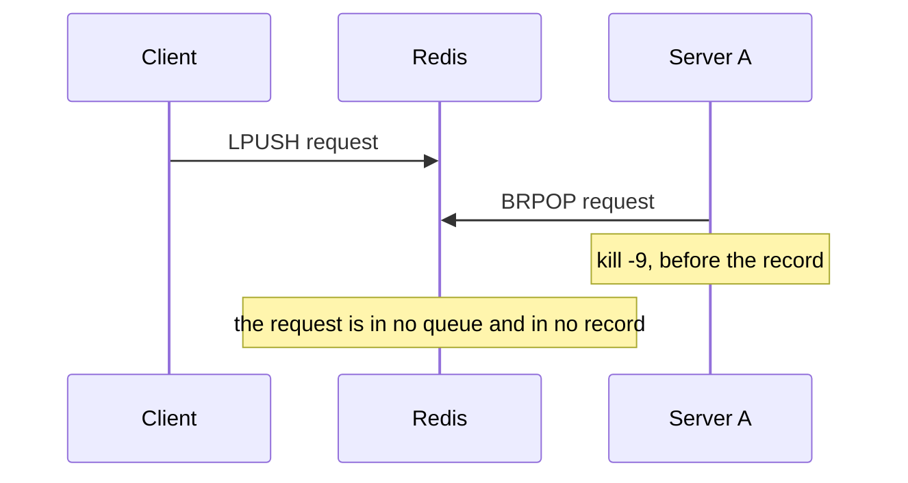

# Taking requests

A server takes a request off its queue and onto a list of its own in one
atomic command, so a crash can never lose a request without a trace. The
command blocks, so an idle server is handed a new request the moment a client
pushes it.

To watch it step by step, open
[visuals/taking-requests.html](visuals/taking-requests.html) in a browser.

## The pieces

| Redis key | Written by | Holds |
|---|---|---|
| `anycall:requests:<method>` | clients | requests nobody has taken yet |
| `anycall:processing:<server>` | servers | the requests that server is processing, whole |

## The gap a crash could fall into

Servers used to take requests with a plain `BRPOP` and record nothing in Redis
(see [taking-requests-legacy.md](taking-requests-legacy.md)). Recording the
owner afterwards would still be two commands:



Between the two, the request exists only in the server's memory. If the server
dies there, no other server can take it, because it's gone from the queue, and
[reaping](reaping.md) can't fail it back, because nothing says who had it.
Calls wait with no limit by default, so the client would wait forever.

## One command instead

`BRPOPLPUSH anycall:requests:<method> anycall:processing:<server>` pops the
request and pushes it onto the server's processing list in one step. A crash
falls before it or after it:

- **before:** the request is still in its queue, and another server takes it;
- **after:** it's on the list of the server that died, and
  [reaping](reaping.md) fails it back with `ServerLostError`.

The key name is the record of who has the request, so there's no separate
owner record to keep in step with it.


Redis hands each push to exactly one blocked server. The others stay blocked,
so idle servers add nothing to the cost of a call.

When it's done, the server pushes the response, sets its expiry and removes
the request from its processing list, in one round trip, response first. If
the process dies before the removal, the request is failed back as a crash,
but the client pops the real response before that error, because `BRPOP`
takes the oldest.

## One loop, and one connection, per method

`BRPOPLPUSH` reads a single queue, and a blocked command holds its connection
until it returns. So a server runs one read loop per method it serves, each on
its own connection:

```
loop for "analyze":
    wait for a free slot (the method's max_concurrency)
    BRPOPLPUSH requests:analyze processing:A, up to 2s
    hand the request to a worker
```

- **Per-method concurrency** is the loop not asking for the next request until
  a slot frees up. Requests for a busy method stay in their queue, so its
  backlog stays accurate.
- **The server-wide cap** (`max_concurrency` on the server) gates running a
  request, not taking it. A loop blocked in Redis can't hold a server-wide slot
  without starving the other methods, so a request taken while every slot is
  busy waits in the server for one, already safe on the processing list. Taking
  overshoots the cap by at most one request per method.
- **The 2s block** bounds how long `stop` and `unregister` take to reach an
  idle loop. An idle loop costs one command per 2s.

A server uses one connection per method, plus:

- **Java:** one, shared by the responses and the heartbeat. A Lettuce
  connection is shared by every thread, so all workers and the heartbeat write
  on one, but a blocking command holds its connection, so each loop needs its
  own.
- **Python:** one more for each command running at the same time, from
  redis-py's pool. A redis-py connection serves one command at a time, so
  workers writing responses together, and the heartbeat, each borrow one. The
  pool keeps them open, so a busy server ends up with about one per worker.

Blocked connections cost Redis no CPU, only memory, about 57 KB each.

## Why not the alternatives

| | Blocks | Many queues on one connection | No gap on a crash |
|---|---|---|---|
| `BRPOP`, then record the owner | yes | yes | no |
| Lua script + wake channel (before this) | no, a pub/sub wake makes up for it | yes | yes |
| `XREADGROUP` on Streams ([candidate](streams-candidate.md)) | yes | yes | yes |
| `BRPOPLPUSH` (AnyCall) | yes | no, one connection per method | yes |

Before this, servers took requests with a Lua script that popped the request
and recorded the owner in an `anycall:inflight` hash. A script can't block, so
clients published on an `anycall:wake:<method>` channel after every push, every
idle server for the method woke and ran the script, and a 1s fallback covered
missed wakes. That cost 14 commands per call with 1 server and 24 with 6, since
every idle server added its own. `BRPOPLPUSH` trades it for a connection per
method.

## Timings and costs

Measured with the Python library against a local Redis 6.0.16, 300 sequential
calls, `INFO commandstats` minus idle traffic:

| | Value |
|---|---|
| Commands per call, 1, 3 or 6 servers | 9 |
| Idle commands per server | 2.5/s (heartbeat script and its inner commands, one take per 2s) |
| Latency per sequential call, local Redis | ~0.6–0.9ms Python, ~2ms Java |
| Longest an idle loop takes to notice `stop` | 2s |

The 9 are the client's liveness check (`TIME`, `ZCOUNT`), `LPUSH`, `BRPOP` and
`DEL` of its response queue, and the server's `BRPOPLPUSH`, `LPUSH`, `EXPIRE`
and `LREM`.
